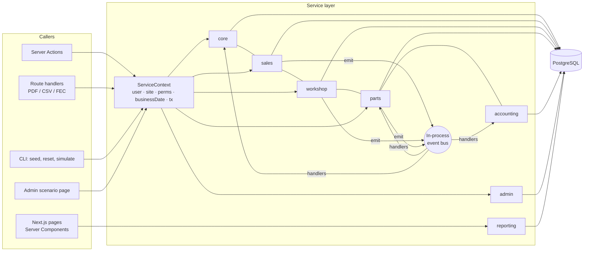
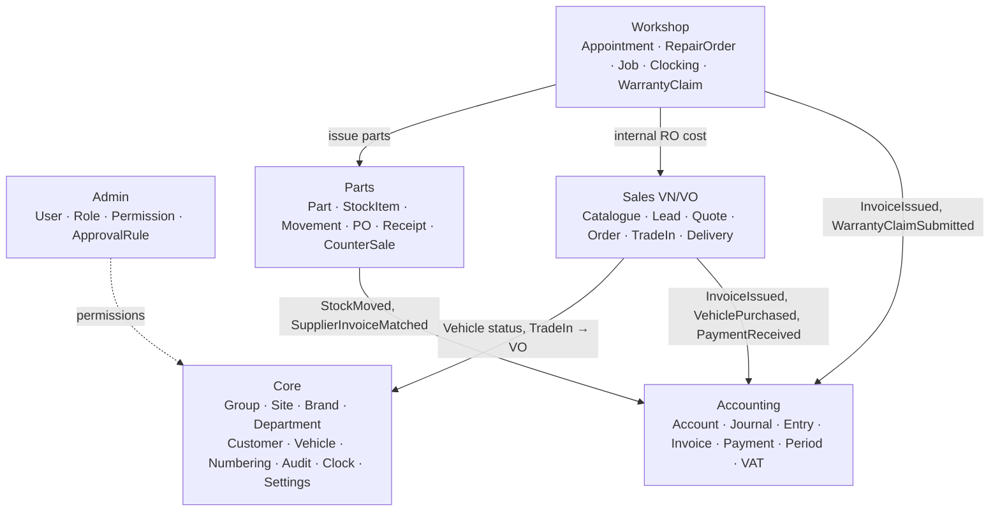
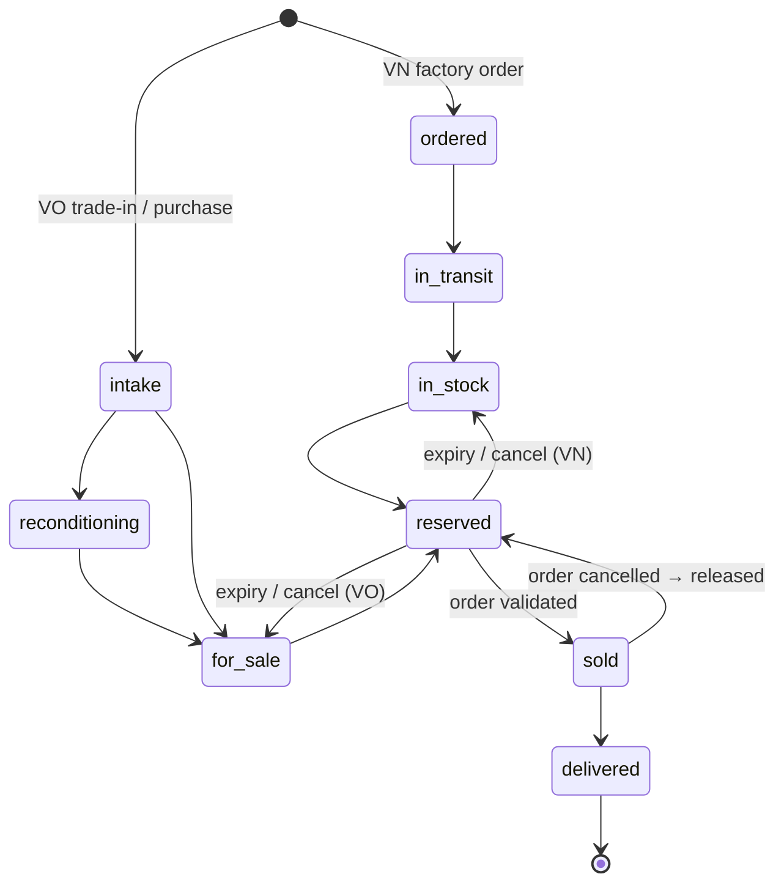
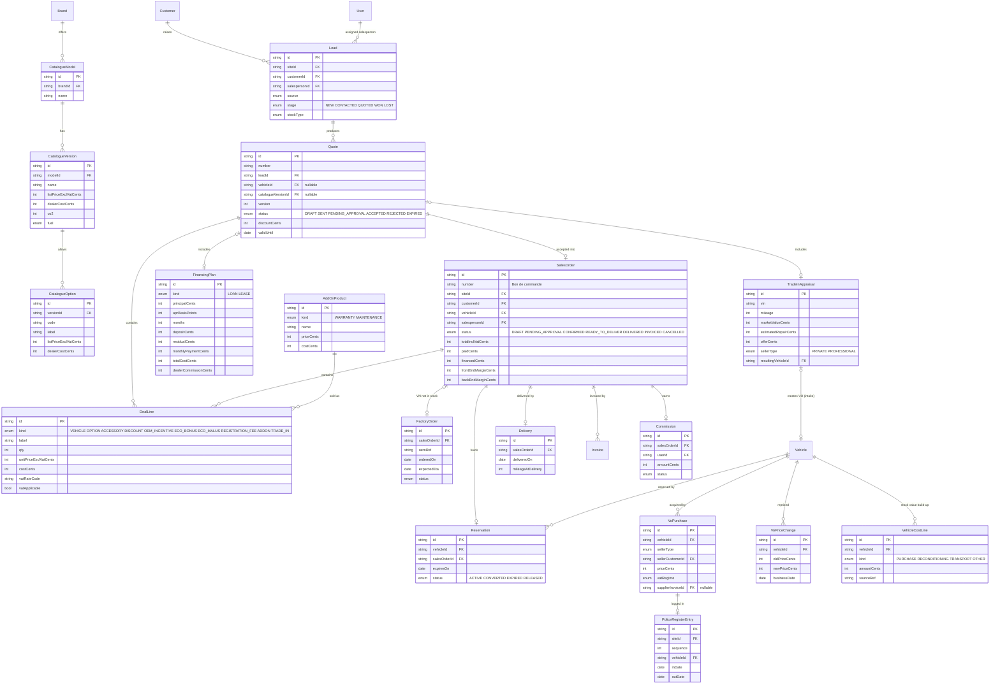
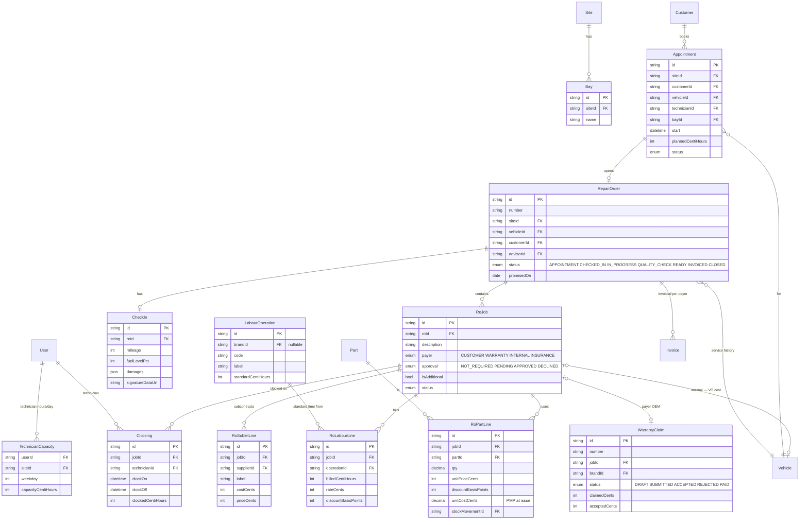
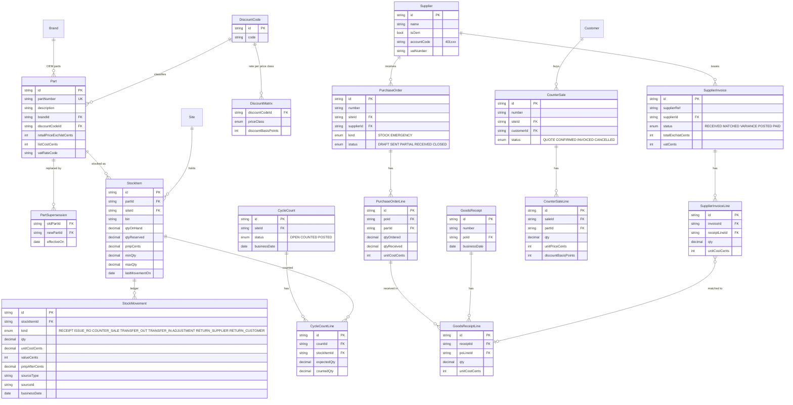
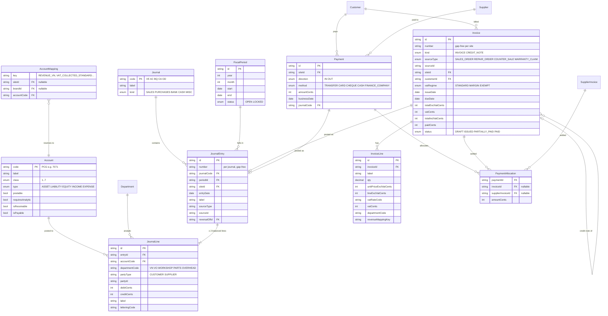

# DMS Simulator — Architecture

> Status: **Phase 0 draft, awaiting approval.**
> Companion docs: [ROADMAP.md](ROADMAP.md) · [DECISIONS.md](DECISIONS.md) · [../CLAUDE.md](../CLAUDE.md)

## 1. Purpose and guiding principles

A web DMS simulator for a French multi-site, multi-brand dealer group: VN/VO sales, workshop, parts, accounting, admin. Used for demos, training and workflow testing.

1. **Every operational action has its downstream effects.** A sale changes stock, issues an invoice, posts journal entries and moves KPIs, all in **one database transaction**.
2. **One service layer, many callers.** The UI (server actions), API routes, the seed script, the scenario runner (CLI and admin page) and the tests all call the same services. Nothing writes business tables directly.
3. **Pure domain functions for every calculation** (pricing, VAT, margin, PMP, labour time, journal entry building). They take plain values and return plain values, so they can be unit-tested without a database.
4. **Nothing country-specific is hard-coded.** VAT rates, chart of accounts, posting account mapping, document number formats and legal mentions come from settings tables.
5. **Time comes from the business clock**, never from `new Date()` inside business code. This makes the simulator's day-by-day advance possible.

## 2. Tech stack

| Concern | Choice |
|---|---|
| Runtime | Node 24, npm |
| App | Next.js 15 (App Router, React 19, Server Components + Server Actions), TypeScript `strict` |
| UI | Tailwind CSS v4, shadcn/ui (Radix), lucide icons, TanStack Table v8, Recharts |
| Forms | react-hook-form + `@hookform/resolvers/zod` |
| Validation | Zod v3, schemas shared by forms, server actions and services |
| DB | PostgreSQL 17 (local Homebrew instance) via Prisma 6 |
| Auth | Auth.js v5 (credentials provider, JWT sessions, bcrypt hashes) |
| i18n | next-intl (messages in `messages/en.json`; `fr`, `es` added later) |
| PDF | `@react-pdf/renderer`, rendered in route handlers |
| Seed / simulation data | `@faker-js/faker` with `fr` locale, deterministic seed |
| Money | integer cents + a small `money` lib (no floats); `decimal.js` only for PMP unit cost |
| Tests | Vitest (unit + service integration against `dms_test` DB), Playwright (e2e) |
| Scripts | `tsx` for CLI scripts (seed, reset, simulate) |

## 3. High-level architecture



### 3.1 Request lifecycle for a mutation

1. A server action receives form data and parses it with the Zod schema.
2. `runCommand(session, 'sales.order', 'validate', fn)` builds a `ServiceContext`:
   - loads the user, their roles and site scopes, and checks the permission (throws `ForbiddenError`);
   - reads the current **business date** from `BusinessClock`;
   - opens a Prisma interactive transaction (`ctx.tx`).
3. The service runs. It loads aggregates, calls pure domain functions, writes rows, and calls `ctx.emit(event)`.
4. Event handlers run **synchronously inside the same transaction** (for example `SalesInvoiceIssued` → accounting posts the entry). If any handler throws (unbalanced entry, locked period, insufficient stock), the whole command rolls back.
5. `ctx.audit(...)` rows and the `DomainEvent` rows are written in the same transaction.
6. The action returns a typed result (`{ ok: true, data } | { ok: false, error }`) and calls `revalidatePath`.

Reads (lists, dashboards) go through module **query** functions (`modules/*/queries`) that also enforce site scope.

### 3.2 Why a synchronous in-transaction bus

Modules stay decoupled (sales does not import accounting), but there is no eventual consistency to explain during a demo: the moment an invoice exists, its journal entry exists. Events are also stored in `DomainEvent` and power the customer/vehicle timelines. See D-004.

## 4. Folder structure

```
.
├── CLAUDE.md
├── docs/                       ARCHITECTURE, ROADMAP, DECISIONS
├── messages/                   en.json (fr.json, es.json later)
├── prisma/
│   ├── schema.prisma           single schema, sections per module
│   ├── migrations/
│   └── seed/                   seed entrypoint + per-module seeders (call services)
├── scripts/                    simulate.ts, reset.ts, fec-export.ts
├── src/
│   ├── app/
│   │   ├── (auth)/login/
│   │   ├── (app)/              authenticated shell: sidebar, site switcher, business date, role switcher
│   │   │   ├── dashboard/
│   │   │   ├── customers/  vehicles/
│   │   │   ├── sales/      (leads, quotes, orders, deliveries, vo-stock, appraisals, catalogue)
│   │   │   ├── workshop/   (planner, repair-orders, clocking, warranty, labour-catalogue)
│   │   │   ├── parts/      (catalogue, stock, purchasing, counter, inventory)
│   │   │   ├── accounting/ (entries, journals, ledgers, receivables, payables, vat, periods, reports)
│   │   │   ├── reports/
│   │   │   └── admin/      (users, roles, permissions, settings, numbering, audit, simulation)
│   │   └── api/            pdf/[doc]/[id], export/csv, export/fec
│   ├── components/
│   │   ├── ui/             shadcn primitives
│   │   └── shared/         DataTable, StatusBadge, Timeline, MoneyCell, PageHeader, KpiCard
│   ├── lib/
│   │   ├── db.ts           Prisma client singleton
│   │   ├── auth.ts         Auth.js config
│   │   ├── money.ts        cents arithmetic, allocation, centralised rounding
│   │   ├── context.ts      ServiceContext, runCommand, runQuery
│   │   ├── events.ts       typed event bus + registry
│   │   ├── errors.ts       DomainError, ForbiddenError, ValidationError, PeriodLockedError…
│   │   ├── rbac.ts         permission keys + can()
│   │   └── csv.ts, pagination.ts, i18n.ts
│   └── modules/
│       ├── core/           org, customers, vehicles, numbering, audit, clock, settings
│       ├── accounting/
│       ├── sales/          vn, vo, deals, financing, commissions
│       ├── parts/
│       ├── workshop/
│       ├── admin/          users, roles, approvals
│       ├── reporting/      KPI + report queries (read-only)
│       └── simulation/     scenario runner, generators, rates config
└── tests/
    ├── unit/               mirrors modules/*/domain
    ├── integration/        service tests against dms_test
    └── e2e/                Playwright, one spec per critical flow
```

Every module has the same internal layout:

```
modules/<name>/
  domain/      pure functions and types (no Prisma, no I/O) → unit tested
  services/    use cases: take ctx + validated input, use ctx.tx, emit events
  queries/     read models for pages and reports
  schemas/     Zod schemas (shared with forms)
  handlers/    subscribers to other modules' events
  events.ts    events this module publishes (typed)
  ui/          module-specific React components
  index.ts     public API: the only file other modules may import
```

**Module boundary rule:** a module may import another module's `index.ts` (services, queries, types) but never its internals. Accounting never imports sales; it subscribes to events. An ESLint `no-restricted-imports` rule enforces this.

## 5. Cross-cutting design

### 5.1 Money, quantities, time
- All amounts are `Int` **cents**, named `*Cents` (`unitPriceCents`, `totalExclVatCents`).
- `lib/money.ts` is the only place that rounds: half-up (`ROUND_HALF_UP`) to the cent, with largest-remainder allocation when a total is split across lines (so VAT per line adds up to VAT on the document).
- VAT is calculated **per line on the excl.-VAT amount**, then summed per rate (configurable later).
- PMP (weighted average cost) is stored as `Decimal(18,4)` cents per unit to avoid drift; every *posted* value is rounded to cents.
- Parts quantities: `Decimal(12,3)` (litres of oil, metres of hose).
- Labour time: `Int` **centi-hours** (`150` = 1.50 h), for both standard time and clocked time.
- Dates: business documents carry a `businessDate` (`Date`, no time) from the business clock, plus `createdAt` (real timestamp) for auditing.

### 5.2 Document numbering (gap-free)
`DocumentSequence(siteId, docType, fiscalYear, prefix, nextValue, padding)`. A number is taken with `UPDATE … SET next_value = next_value + 1 … RETURNING` inside the business transaction, so the row is locked until commit and rolled back with it. Numbers are assigned **only at issue** (a draft invoice has no number). Format from settings, e.g. `NTE-FA-2026-000123`. Invoices are never deleted; corrections go through a credit note.

### 5.3 Audit trail
`AuditLog(at, userId, siteId, action, entityType, entityId, before JSON, after JSON, businessDate)` written by `ctx.audit()` in every service. The activity log viewer reads it; entity pages show it as a timeline next to the `DomainEvent` stream.

### 5.4 RBAC
- Permission key = `module.resource` × action (`view | create | edit | validate | delete`), e.g. `sales.order:validate`.
- `Role` ↔ `Permission` many-to-many. `UserRole(userId, roleId, siteId | null)`: `null` means all sites.
- `can(ctx, key, action, siteId?)` used in `runCommand` and in queries; the sidebar is built from the same check.
- **Approval thresholds**: `ApprovalRule(key, thresholdPct|thresholdCents, approverRoleId)`. A service that breaches a rule creates an `ApprovalRequest` and leaves the document in `pending_approval`.

### 5.5 Business clock and simulation
- `BusinessClock` (single row): `currentDate`. `ctx.businessDate` is read once per command.
- `clock.advanceDay()` runs end-of-day jobs through services: expire reservations, refresh stock ageing alerts, flag overdue receivables, auto-suggest parts POs.
- The scenario runner (`modules/simulation`) loops day by day, draws activity from configurable rates (Poisson-like with a seeded RNG), calls services as a system user per site, and advances the clock. It logs a run report (events, errors, trial balance check).

### 5.6 Validation and errors
Zod at the edge (action) **and** inside the service (defence in depth for CLI callers). Business rule violations raise typed `DomainError(code, params)` mapped to translated messages in the UI.

### 5.7 Lists
A shared `DataTable` (TanStack) driven by URL search params (`?q=&status=&sort=&page=`), server-side filtering/pagination via a generic `paginate()` helper, and a CSV export route reusing the same query.

## 6. Domain model

The schema is a single Prisma file; diagrams are split by module for readability. Common columns (`id` cuid, `createdAt`, `updatedAt`, `createdById`) are omitted. `siteId` is on every operational table.

### 6.1 Context map



### 6.2 Core and admin

```mermaid
erDiagram
  Group ||--o{ Site : has
  Group ||--o{ Brand : sells
  Site ||--o{ SiteBrand : carries
  Brand ||--o{ SiteBrand : "is carried by"
  Site ||--o{ Department : has
  Country ||--o{ Site : "located in"
  Country ||--o{ VatRate : defines

  User ||--o{ UserRole : has
  Role ||--o{ UserRole : "granted via"
  Site |o--o{ UserRole : "scoped to (null = all)"
  Role ||--o{ RolePermission : has
  Permission ||--o{ RolePermission : in
  Role ||--o{ ApprovalRule : approves
  ApprovalRule ||--o{ ApprovalRequest : triggers
  User ||--o{ ApprovalRequest : decides

  Customer ||--o{ Contact : has
  Customer ||--o{ Vehicle : "owns (current)"
  Vehicle ||--o{ VehicleStatusHistory : logs
  Vehicle ||--o{ VehicleOption : has
  Brand ||--o{ Vehicle : make
  Site ||--o{ Vehicle : "stocked at"

  Site ||--o{ DocumentSequence : numbers
  User ||--o{ AuditLog : performs
  Site ||--o{ DomainEvent : records

  Group {
    string id PK
    string name
  }
  Site {
    string id PK
    string groupId FK
    string code "NTE, REN, ANG"
    string name
    string countryCode FK
    int labourRateCents
  }
  Brand {
    string id PK
    string name
    string oemSupplierId FK
    string oemCustomerId FK
  }
  SiteBrand {
    string siteId FK
    string brandId FK
  }
  Department {
    string id PK
    string siteId FK
    enum code "VN VO WORKSHOP PARTS ACCOUNTING OVERHEAD"
  }
  Country {
    string code PK
    string currency
    string defaultLocale
  }
  VatRate {
    string id PK
    string countryCode FK
    string code "STANDARD REDUCED…"
    int rateBasisPoints
    date validFrom
    date validTo
  }
  User {
    string id PK
    string email UK
    string passwordHash
    string name
    bool isTechnician
    bool active
  }
  Role {
    string id PK
    string key UK
    string name
  }
  Permission {
    string id PK
    string key "sales.order"
    enum action "view create edit validate delete"
  }
  RolePermission {
    string roleId FK
    string permissionId FK
  }
  UserRole {
    string userId FK
    string roleId FK
    string siteId FK "nullable"
  }
  ApprovalRule {
    string id PK
    string key "deal.discount"
    int thresholdBasisPoints
    string approverRoleId FK
  }
  ApprovalRequest {
    string id PK
    string ruleId FK
    string entityType
    string entityId
    enum status
    string decidedById FK
  }
  Customer {
    string id PK
    enum kind "INDIVIDUAL COMPANY OEM"
    string name
    string siren
    string vatNumber
    enum priceClass "RETAIL TRADE INTERNAL WARRANTY"
    bool consentEmail
    bool consentSms
    string accountCode "411xxx"
  }
  Contact {
    string id PK
    string customerId FK
    string name
    string email
    string phone
  }
  Vehicle {
    string id PK
    string vin UK
    string registration
    string brandId FK
    string model
    string version
    date firstRegistration
    int mileage
    enum fuel
    int co2
    string colour
    enum stockType "VN VO NONE"
    enum status
    string siteId FK
    string ownerCustomerId FK
    int stockValueCents
    date stockInDate
    enum vatRegime "STANDARD MARGIN"
  }
  VehicleStatusHistory {
    string id PK
    string vehicleId FK
    enum from
    enum to
    date businessDate
  }
  VehicleOption {
    string id PK
    string vehicleId FK
    string code
    string label
    int priceCents
  }
  DocumentSequence {
    string siteId FK
    enum docType
    int fiscalYear
    string prefix
    int nextValue
  }
  AuditLog {
    string id PK
    datetime at
    string userId FK
    string action
    string entityType
    string entityId
    json before
    json after
  }
  DomainEvent {
    string id PK
    string type
    string siteId FK
    json payload
    date businessDate
    string aggregateType
    string aggregateId
  }
  BusinessClock {
    int id PK
    date currentDate
  }
  Setting {
    string key PK
    json value
    string siteId FK "nullable"
  }
```



Vehicle status lifecycle:



### 6.3 Sales VN / VO



**As built (Phase 3).** The models match the diagram, with these differences:
- **Delivery:** there is no `Delivery` entity; delivery date and mileage are stored on `SalesOrder`, and the invoice is linked through `SalesOrder.invoiceId`.
- **Statuses:** a quote is `DRAFT → PENDING_APPROVAL / SENT → ACCEPTED / DECLINED / EXPIRED`; an order is `CONFIRMED → INVOICED → DELIVERED` or `CANCELLED`.
- **Reservations:** a reservation belongs to a quote and becomes `CONVERTED` when the customer signs.
- **Approvals:** discount approvals use the generic `ApprovalRule` / `ApprovalRequest` tables (D-036).
- **VO purchases:** `VoPurchase.source` is `TRADE_IN`, `PRIVATE`, `PROFESSIONAL` or `OPENING`, with the seller as a customer or a supplier.
- **Factory orders:** a factory order points to its vehicle and, for customer orders, to the order.
- **Vehicle record:** core keeps the vehicle, but only the sales flows create stock cars and change their status, prices and site (`trusted` calls). The vehicle screens register customers' cars and correct descriptive data (D-048).
- **Services:** `leads`, `quotes`, `reservations`, `orders`, `trade-in`, `vn-stock` and `vo-stock`. Pure rules live in `domain/pricing.ts` (deal lines, VAT, margins, commission), `fees.ts` (registration fee, eco bonus and malus), `financing.ts` (payments, APR) and `workflow.ts` (stage and status guards, approval level).

### 6.4 Workshop (after-sales)



### 6.5 Parts



### 6.6 Accounting



## 7. Accounting engine

### 7.1 Posting service
Builders in `modules/accounting/domain/entry.ts` turn documents into an `EntryDraft` whose lines reference either a mapping key (`{ key: "REVENUE_LABOUR" }`) or an account code. `postEntry(ctx, draft, { brandId? })` then:
1. Resolves each key through `AccountMapping` (most specific wins: site + brand → site → brand → global); a missing key raises `mapping_missing`.
2. Validates with `validateEntry` and reports every problem at once: fewer than 2 lines, a line both debit and credit or negative, unknown / non-postable account, class 6/7 without a department, receivable/payable account without the right party, Σ debit ≠ Σ credit.
3. Finds or creates the `FiscalPeriod` for the entry date; rejects if `LOCKED`.
4. Takes the next gap-free number of the journal series (`OD-2026-000042`) and writes the entry and its lines in the command's transaction.

Postgres repeats the essential checks (D-020): a deferred trigger rejects unbalanced entries at commit, row triggers reject inserts into locked periods and any update except lettering.

Entries are immutable. Manual and opening entries are corrected by `reverseEntry` (mirrored entry, `reversalOfId`); invoices by credit notes.

### 7.2 Posting rules (default PCG mapping, all configurable)

Inventory is **perpetual** (see D-005): purchases go to class 60x, stock entries/exits go through 603x ↔ 37x so that stock accounts always equal the stock sub-ledger.

| Event | Journal | Debit | Credit |
|---|---|---|---|
| VN arrival: OEM invoice | AC | 607100 VN purchases (VN) + 445660 VAT deductible | 401100 OEM |
| VN arrival: stock entry | OD | 371000 VN stock | 603710 VN stock variation (VN) |
| VN / VO sales invoice | VE | 411000 customer | 707100 VN / 707200 VO (net of discount), 706500 add-ons, 445710 VAT or 445715 VAT on margin; pass-through lines with no VAT: 467100 registration certificate, 447100 eco malus; eco bonus advanced: Dr 443100 |
| Cost of sale (at invoice) | OD | 603710 / 603720 | 371000 / 372000 |
| Trade-in taken at signature | AC + OD | 607200 VO purchases (VO); then 372000 | 467400 private seller (party = customer); then 603720 |
| Trade-in settles the invoice | OD | 467400 | 411000 |
| Finance company takes over the financed amount | OD | 467300 finance company | 411000 |
| Dealer finance commission | OD | 467300 | 706600 finance commission (back-end) |
| OEM incentive claim | VE | 411100 OEM | 707100 + 445710 |
| Add-on and accessory costs (accrual) | AC | 604100 / 607400 | 408100 |
| VO purchase from a private seller | AC + BQ | 607200 (VO), then 467400 | 467400 (party = customer), then 512100 |
| VO purchase from a trader | AC | 607200 (VO) + 445660 if the trader charges VAT | 401000 supplier |
| VO stock entry / capitalised cost | OD | 372000 VO stock | 603720 (VO); the cost itself: Dr 604000 + 445660 / Cr 401000 |
| Deposit on an order | BQ/CA | 512100 / 530000 | 411000 (on account, allocated to the invoice when it is issued) |
| RO customer invoice | VE | 411 | 7061 labour (WORKSHOP), 7073 parts (PARTS), 7062 sublet (WORKSHOP), 44571 |
| RO warranty | VE | 4111 OEM warranty receivable | 7063 warranty labour (WORKSHOP), 7074 warranty parts (PARTS) |
| RO internal (VO reconditioning) | OD | 3712 VO stock | 7064 internal labour (WORKSHOP), 7075 internal parts (PARTS) |
| Parts issue to RO / counter | OD | 60373 (PARTS) | 3713 parts stock |
| Parts receipt (goods received not invoiced) | OD | 3713 | 60373 (PARTS); purchase side via 408 until invoice |
| Supplier invoice matched | AC | 6073 (PARTS) + 44566 | 401 (clears 408 accrual) |
| Inventory variance | OD | 60373 (PARTS) | 3713 (or reverse) |
| Customer payment | BQ/CA | 512 bank / 530 cash / 4671 finance company | 411 |
| Supplier payment | BQ | 401 | 512 |

Exact accounts are seed data in `AccountMapping`; the table above is the default for France.

### 7.3 VAT
- `VatRate` per country with validity dates; lines carry a `vatRateCode`.
- **Margin regime** (biens d'occasion, art. 297 A CGI): VAT base = (sale price incl. VAT − purchase price) × rate / (1 + rate), floored at zero; no VAT shown on the invoice; legal mention from settings. Reconditioning costs are **not** deducted from the margin base (their own input VAT is deductible). Unit-tested.
- VAT report per period: collected by rate, deductible on goods / services, margin-regime base, net due.

### 7.4 Period close
Monthly `FiscalPeriod`s. Checklist (`closeChecklist`): period open, earlier periods with entries locked, business date past month end, period trial balance balanced (blocking); draft invoices (warning). Lock → locked periods reject postings at service and database level. Only `Admin` (`accounting.period:delete`) can reopen, latest locked period first, with an audited reason.

### 7.5 Reports and exports
Trial balance, general ledger, customer/supplier ledgers with ageing (0–30/31–60/61–90/>90), P&L by department, gross margin by department, stock value (VN/VO/Parts, reconciled to 37x), VAT report, FEC export (the 18 standard columns, `|` separated).

## 8. Key domain rules (enforced in services)

- A vehicle has at most one `ACTIVE` reservation and can be on at most one non-cancelled sales order (DB partial unique index + service check).
- Reservations expire after N days (setting) at end-of-day; expiry releases the vehicle.
- Delivery requires `paidCents + financedCents ≥ totalInclVatCents`.
- Cancelling an order releases the vehicle and its reservation; if already invoiced, cancellation needs a credit note.
- Discounts above an `ApprovalRule` threshold put the quote in `PENDING_APPROVAL`.
- VO stock value = purchase price + Σ `VehicleCostLine` (reconditioning, transport).
- Stock ageing alerts at 60/90/120 days (configurable) from `stockInDate`.
- Parts issue cannot drive `qtyOnHand` below zero unless the site setting allows negative stock (default off).
- PMP on receipt: `newPmp = (qtyOnHand × pmp + qtyIn × unitCost) / (qtyOnHand + qtyIn)`; issues are valued at the current PMP.
- An RO cannot be invoiced while a job is `PENDING` approval or a technician is still clocked on.
- An RO with several payers produces one invoice per payer (customer, OEM, insurer); internal jobs produce a cost transfer, not an invoice.
- Nothing posts into a locked period.

## 9. Domain events (initial catalogue)

| Module | Event | Main subscribers |
|---|---|---|
| sales | `QuoteAccepted`, `SalesOrderConfirmed`, `SalesOrderCancelled`, `VehicleDelivered`, `TradeInReceived`, `VoPurchased`, `VehicleCostAdded` | core (vehicle status), accounting |
| core | `VehicleStatusChanged`, `InvoiceIssued`, `PaymentReceived`, `PaymentMade` | accounting, reporting timeline |
| workshop | `PartsRequestedForJob`, `RoInvoiced`, `InternalRoClosed`, `WarrantyClaimSubmitted` | parts, sales (VO cost), accounting |
| parts | `StockMoved`, `StockBelowMinimum`, `GoodsReceived`, `SupplierInvoiceMatched`, `InventoryAdjusted` | accounting, purchasing suggestions |
| accounting | `PeriodLocked` | — |
| clock | `BusinessDayAdvanced` | sales (reservation expiry, ageing), accounting (overdue), parts (reorder suggestions) |

`Invoice` lives in the accounting module (it owns receivables) and is created through `createAndIssueInvoice()` called by sales/workshop/parts services. Issuing posts the sales entry directly in the same transaction (D-023) and then emits `InvoiceIssued` for other modules. Accounting also emits `JournalEntryPosted`, `PaymentRecorded`, `PeriodLocked` and `PeriodReopened`.

## 10. UI shell and navigation

- Left sidebar grouped by module, filtered with `can(view)`. Top bar: site switcher (sites the user is scoped to), **business date** chip, demo **role switcher**, user menu, language switcher (later).
- Dense tables, sticky headers, status badges (one colour scale per lifecycle), entity pages with a header card, tabs, and a right-hand timeline (events + audit).
- Sales pipeline: kanban (dnd-kit) and list views over the same query.
- Workshop planner: day/week grid, rows = technicians or bays, load bar vs. capacity.
- Role dashboards: Dealer Principal (group KPIs), Sales Manager, Salesperson, Service Manager, Service Advisor, Technician (my jobs + clocking), Parts Manager, Accountant.

## 11. Testing strategy

| Layer | Tool | Scope |
|---|---|---|
| Unit | Vitest | every `domain/` function: money/rounding, VAT (standard + margin), deal pricing, front/back-end margin, commission, APR/monthly payment, PMP, labour billing & efficiency, journal entry builders (balance), numbering format, ageing buckets |
| Integration | Vitest + `dms_test` Postgres | services with a real transaction: posting rejects unbalanced / locked period, double-sale prevention, reservation expiry, gap-free numbering under rollback |
| E2E | Playwright | flows 1–6 from the brief, against a freshly reset DB |
| Invariant | Vitest | after seed and after `simulate --days 30`: trial balance balances, stock accounts = stock sub-ledgers, receivables = open invoices |

## 12. Seed and simulation

- `npm run db:reset` → drop, migrate, seed. Deterministic (`faker.seed(42)`).
- Seed creates: 1 group, 3 sites (Nantes, Rennes, Angers), 2 brands, ~25 users covering every role (password `demo1234`, documented in CLAUDE.md), ~300 customers, ~150 VN/VO stock vehicles, ~2,000 part references with stock per site, labour catalogue, chart of accounts and mappings, VAT rates, numbering, approval rules.
- **History** (~6 months) is generated by the scenario runner itself: the seed sets the business clock 180 days back and calls `simulate` so every past document went through the real services and posted real entries. The clock then lands on the current date.
- `npm run simulate -- --days 30 --site nantes [--rates ./rates.json]`.
